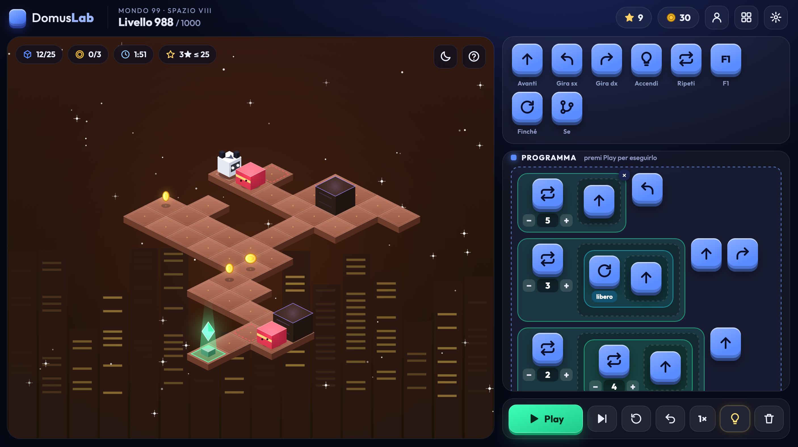

# DomusLab Game


DomusLab Game is a sophisticated web-based interactive application designed with a modular architecture, featuring custom gameplay mechanics, dynamic rendering pipelines, and dedicated procedural generation and verification tools.

---

## Preview

<p align="center">
  
</p>

---

## Table of Contents

- [Overview](#overview)
- [Project Architecture](#project-architecture)
- [Key Features](#key-features)
- [Directory Structure](#directory-structure)
- [Prerequisites](#prerequisites)
- [Installation and Setup](#installation-and-setup)
- [Development and Tooling](#development-and-tooling)
- [Versioning and Distribution](#versioning-and-distribution)
- [License](#license)
- [Contatti](#contatti)

---

## Overview

DomusLab Game combines clean separation of concerns with an optimized client-side execution loop. Built natively with modern web technologies, it ensures high responsiveness, fluid animations, and extensible code patterns suitable for both casual execution and future feature expansions.

## Project Architecture

The application relies on a decoupled architecture where rendering, game state management, input handling, and configuration data operate independently:

- **Engine Core**: Manages the main game loop, delta time calculations, state transitions, and collision detection frameworks.
- **Rendering Pipeline**: Handles canvas or DOM-based rendering operations, optimizing draw calls and graphical updates.
- **Data & Configuration**: Centralizes level parameters, skin definitions, themes, and static asset mapping.

## Key Features

- **Modular Component Design**: Clear boundaries between core logic, UI rendering, level editors, and data management.
- **Procedural Level Generation**: Integrated scripting tools to automate map creation and layout structuring.
- **Integrity Verification**: Automated validation protocols to ensure level consistency and prevent runtime execution anomalies.
- **Customization Framework**: Extensible themes and skin management modules allowing extensive visual styling.
- **Optimized Distribution**: Minified or bundled distribution assets ready for high-performance production deployment.

## Directory Structure

```text
domuslab/
├── css/
│   └── style.css           # Core styling and layout definitions
├── dist/
│   └── domuslab.html       # Production-ready compiled distribution package
├── js/
│   ├── data.js             # Static game data and configuration parameters
│   ├── editor.js           # Level editor interface and logic
│   ├── engine.js           # Main execution loop and state management
│   ├── game.js             # Primary game orchestration logic
│   ├── levels.js           # Level parsing and progression handling
│   ├── render.js           # Graphical rendering and view updates
│   ├── skins.js            # Visual skin definitions and assets manager
│   └── themes.js           # Dynamic theming logic
├── tools/
│   ├── build-single.js     # Build script for single-file deployment
│   ├── generate-levels.js  # Procedural level generation utility
│   └── verify-levels.js    # Map integrity and rule verification script
├── index.html              # Main application entry point
├── package.json            # Project dependencies and build scripts
├── screenshot.png          # Application preview image
└── LICENSE                 # Software licensing details
